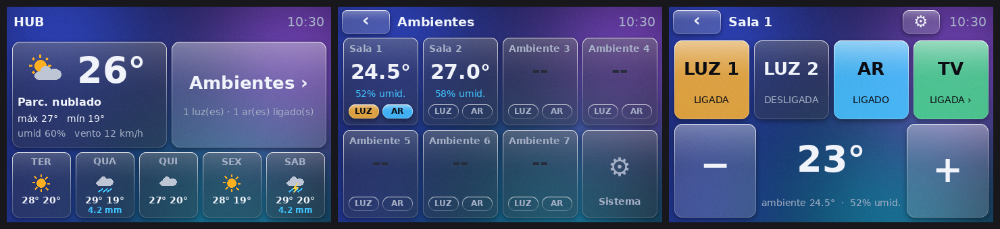

# Orange Pi 4 Pro + 3.5" SPI touch panel + Home Assistant

A complete, local-first automation hub for a set of rooms, with **Home Assistant** at the centre. It brings
appliances of different brands and technologies together, and offers three ways to control them: a touch panel
on the server itself, a web dashboard for monitors and phones, and the controllers installed in each room.
It is designed to keep working without an internet connection.



## What the system does

| Area | What it controls | How |
|---|---|---|
| Climate | air conditioners of any brand | the manufacturer's integration in Home Assistant, or infrared from the room controller |
| Lighting | circuits and switches | integrations (Tuya and others), or relays on the controllers |
| TV and audio | power, volume, mute | local and cloud integrations |
| Environment | temperature, humidity, gas, presence | sensors on the appliances and on the controllers |
| Bluetooth | BLE sensors and devices in each room | the controllers act as Home Assistant antennas |
| Server networking | Wi-Fi and Bluetooth | configured from the touch screen itself |

Home Assistant is what ties everything together: each appliance comes in through an integration, becomes an
entity, and from then on can be placed in any room of the panel without writing code.

This repository documents a real installation, including what worked and what did not. It may save you time if
you have:

- an **Orange Pi 4 Pro** and want to run Home Assistant on it, booting from an M.2 SSD;
- a **3.5" Raspberry Pi display** (480×320, SPI, resistive touch) that stays white on boards that are not a
  Raspberry Pi;
- the wish for **your own touch panel** for Home Assistant, lightweight and without a browser;
- appliances with an **infrared remote** to integrate using ESP32 and ESPHome.

The interface of the panel and the documents under `docs/` are in Portuguese. The code is commented in English.

## What is in here

| Folder | Contents |
|---|---|
| [`ctrl-00/lcd35/`](ctrl-00/lcd35/) | the 3.5" touch panel: display driver and the whole interface |
| [`ctrl-00/automacao/`](ctrl-00/automacao/) | the server's Docker stack: Home Assistant, Mosquitto and ESPHome, with a dashboard and a theme |
| [`esphome/`](esphome/) | firmware for a room controller and the Samsung air conditioner component |
| [`docs/`](docs/) | project specification, the server as built, and notes on each integration (Portuguese) |

## The 3.5" display on the Orange Pi 4 Pro

These displays (sold as "3.5 inch RPi LCD", MHS-3.5 and similar) plug into the 40-pin header and talk over SPI.
On a Raspberry Pi they rely on a kernel driver installed by a vendor script. The official Orange Pi 4 Pro image
(Debian 12, kernel 5.15) has **no** driver for the panel or for its touch controller, which is why the screen
stays white.

The way out used here is a **user-space driver**: a Python program talks to the display controller directly
through `spidev`. The screen shows what that program draws; it does not become a second system monitor.

### Wiring

The display plugs straight onto the header. The signals used are:

| Physical pin | Signal | On the Orange Pi 4 Pro |
|---|---|---|
| 19 | MOSI | SPI3 |
| 21 | MISO | SPI3 |
| 23 | SCLK | SPI3 |
| 24 | display CS | SPI3 CS0 |
| 26 | touch CS | SPI3 CS1 |
| 18 | DC (data or command) | GPIO 354 (PL2) |
| 22 | RESET | GPIO 119 (PD23) |

### Step by step

1. Enable SPI on the header. In `/boot/orangepiEnv.txt`, add:

   ```
   overlays=spi3-cs0-cs1-spidev
   ```

   Reboot. `/dev/spidev3.0` and `/dev/spidev3.1` should appear.

2. Install the dependencies:

   ```bash
   sudo apt install python3-spidev python3-numpy python3-pil
   ```

3. Test the display. Four coloured bars and two lines of text should appear:

   ```bash
   sudo python3 ctrl-00/lcd35/lcd.py
   ```

4. For the full panel, copy `rooms.example.json` to `rooms.json`, install the
   [`lcd35-panel.service`](ctrl-00/lcd35/lcd35-panel.service) unit and provide a Home Assistant long-lived token
   with [`set-token.sh`](ctrl-00/lcd35/set-token.sh).

5. Calibrate the touch from the panel itself: Sistema → Tela → Calibrar toque.

### Pitfalls

- **Do not use `overlays=lcd`.** That overlay is for the official Orange Pi DSI display. With the SPI display
  plugged in, the board hangs at boot. Recovering means editing the card on another computer.
- **The panel is 16-bit, with 16-bit registers.** Every command byte is sent as two bytes (`0x00`, value).
- **Frame rate.** At 32 MHz a full frame takes about 0.1 s: roughly 10 frames per second.
- **Backlight.** On this model it is wired straight to the supply; brightness is reduced by darkening the picture
  itself.
- **Viewing angle.** The panel is TN: colours shift when seen from the side. For a new installation, prefer an
  IPS display with capacitive touch.

### How the panel talks to Home Assistant

The panel is a Home Assistant client over the REST API, authenticated with a long-lived token:

- it reads the state of every entity every 2 seconds and redraws only when something changes;
- it acts through Home Assistant's own services (`homeassistant.toggle`, `climate.set_temperature`,
  `media_player.volume_set` and others), so it works with any integration;
- each room is one line of `rooms.json` pointing at entities: light, second light, air conditioner, temperature
  and TV. The choice is made on the screen itself, with the ⚙ button of the room, from the list of what exists in
  Home Assistant;
- the weather forecast on the start screen comes from Home Assistant's `weather` entity.

The same set of entities appears in the web dashboard at
[`ctrl-00/automacao/homeassistant/dashboards/hub.yaml`](ctrl-00/automacao/homeassistant/dashboards/hub.yaml),
with its own theme and a kiosk mode for dedicated monitors.

### The panel

| File | Role |
|---|---|
| `lcd.py` | ILI9486 driver: initialisation, frame transfer, 180° rotation and brightness |
| `status.py` | touch reading and calibration (XPT2046) and system data |
| `panel.py` | main loop, Home Assistant communication and the room screens |
| `settings.py` | on-screen Wi-Fi and Bluetooth, virtual keyboard, settings and room configuration |
| `controllers.py` | ESP controllers: the room each one serves, the state of its terminals and tests |
| `glass.py` | frosted-glass visual theme, applied to every control |
| `make_media.py` | builds the intro and the screensaver from a logo and a video |

One interface detail that applies to any panel on top of cloud integrations: a tapped value stays "pending"
until the appliance confirms it. Without that, the screen shows the new value, goes back to the old one and then
changes again.

## Home Assistant on the Orange Pi 4 Pro

Home Assistant OS has no image for this board. Here it runs in a container, on top of the official Orange Pi
Debian image. The full account is in [docs/CTRL-00.md](docs/CTRL-00.md). The points that cost the most time:

- **Booting from M.2 without a card.** The bootloader cannot read NVMe on its own: it goes into the board's SPI
  flash and the system lives on the SSD. The SPI option of `nand-sata-install` writes the bootloader file
  truncated by 32 KB; here it was written by hand, whole.
- **Docker before the network.** Host-network containers copy `/etc/resolv.conf` when they start. If Docker comes
  up before Wi-Fi, Home Assistant has no DNS and every cloud integration shows as unavailable. The fix is to make
  Docker wait for a name server.
- **Power.** A computer's USB port cannot sustain the board with an SSD.

## ESP32-S3 controllers and infrared

[`esphome/esp-01.yaml`](esphome/esp-01.yaml) is the controller of one room. It joins Home Assistant through the
ESPHome integration and provides:

- an **infrared receiver**, which logs any remote control and recognises the common protocols on its own (NEC,
  Samsung, LG, Sony, Panasonic and others);
- an **infrared emitter**, with an action that sends any captured command: useful for a TV, audio, a fan or an
  air conditioner of any brand;
- a **learning mode**, which hands the next received command to the server;
- a **Bluetooth proxy**, which extends Home Assistant's reach to that room;
- sensors and diagnostics (Wi-Fi signal, internal temperature, gas).

For air conditioners, ESPHome already ships support for several brands, such as Midea, Gree, LG, Daikin,
Fujitsu, Mitsubishi and those using the Coolix protocol. In those cases one line of configuration is enough.

### Samsung air conditioners, as an example of a protocol without ready-made support

ESPHome does not include the protocol of Samsung split units. For them,
[`esphome/components/samsung_ac_ir`](esphome/components/samsung_ac_ir/) is a climate component that builds the
complete command (mode, temperature, fan and louvres) and follows the original remote through the receiver. The
method used to map the format, described in [docs/DISPOSITIVOS.md](docs/DISPOSITIVOS.md), works as a recipe for
any other brand without support.

**Current status, plainly:** capture, decoding and command building are validated. The logic recreates 46 of 47
frames captured from the real remote, byte for byte; the one that differs is a corrupted reception. Replaying a
captured frame did control the appliance. Sending **generated** frames has not yet been confirmed on the
appliance and is under investigation.

## Secrets

No password, key or token is in this repository. On the server they live in `/opt/automacao/.env` and in
`/opt/automacao/esphome/secrets.yaml`. The templates without values are
[`ctrl-00/automacao/.env.example`](ctrl-00/automacao/.env.example) and
[`esphome/secrets.example.yaml`](esphome/secrets.example.yaml).

The entity names that appear in the examples, such as `climate.sala_1_ar`, are those of the reference
installation. Replace them with your own.

## Electrical safety

Work on the distribution board and on 127 or 220 V circuits must be designed and carried out by a qualified
professional, following the standards in force where you are (in Brazil, ABNT NBR 5410 and NR-10). The
controllers are never wired directly to the loads.

## License

[MIT](LICENSE).
